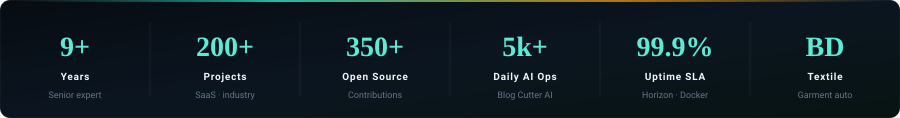

<div align="center">



<br/>

```text
┌────────────────────────────────────────────────────────────────────────────┐
│  IMRAN AHMED                                                               │
│  Senior Laravel & Full-Stack Engineer  ·  Principal Developer              │
│  Senior Developer @ Rankinsoft                                             │
│  9+ Years Experience · 200+ Projects · 350+ Open Source · 99.9% SLA        │
└────────────────────────────────────────────────────────────────────────────┘
```


<br/>

[](https://imrandev.bd/)
[](https://packagist.org/packages/imrandevbd/)
[](https://github.com/imranbru99)
[](https://www.linkedin.com/in/imranbru99/)
[](https://github.com/imranbru99)
[](mailto:me@imrandev.bd)
[](http://wa.me/+8801576918420)
[](https://x.com/imrandev_bd)

</div>

---

## Professional Summary

> **Nine-plus years engineering systems that hold under real traffic, real factory floors, and real operational risk.**

**Imran Ahmed** is a **Senior Laravel & Full-Stack Engineer** and **Principal Developer** with **9+ years** of continuous production experience. His work spans high-availability backends, distributed queue infrastructure, production AI systems, enterprise SaaS, and **garment & textile automation platforms for Bangladesh RMG and mill operations**.

He currently serves as **Senior Developer at Rankinsoft**, contributing across several production projects. Previously, as **Principal Developer at [Blog Cutter AI](https://blogcutter.com)**, he delivered an autonomous publishing platform sustaining **5,000+ daily AI operations** at **99.9% uptime**. He maintains **350+ open-source contributions** and publishes packages under Packagist [`@imrandevbd`](https://packagist.org/packages/imrandevbd/).

| Profile | Detail |
|---|---|
| **Current position** | Senior Developer — Rankinsoft · Dhaka / Hybrid |
| **Core specialty** | Garment automation Bangladesh · Textile automation BD · Production AI |
| **Previous leadership** | Principal Developer — [Blog Cutter AI](https://blogcutter.com) |
| **Open source** | 350+ contributions · Packagist author `@imrandevbd` |
| **Security track record** | Cloudflare WAF · OWASP Top 10 · ~95% automated threat traffic filtered |
| **Performance track record** | MySQL + Redis · ~40% query / CPU reduction across 1M+ records |
| **Based in** | Bangladesh · UTC+6 · Dhaka / Rangpur |

<div align="center">

</div>

---

## Career Impact

<div align="center">

| Professional Tenure | Projects Delivered | Open Source | Concurrent Users |
|:---:|:---:|:---:|:---:|
| **9+ Years** | **200+** | **350+ Contributions** | **100k+** |

| Daily AI Throughput | Platform Uptime | Threat Mitigation | Database Efficiency | Latency Gain |
|:---:|:---:|:---:|:---:|:---:|
| **5,000+ ops/day** | **99.9% SLA** | **~95% filtered** | **~40% load cut** | **~35% p95** |

</div>

---

## Industry Expertise — Garment & Textile Automation (Bangladesh)

With **9+ years** in production software, Imran develops **garment automation** and **textile automation** systems for Bangladesh factories — combining industrial full-stack engineering with AI vision, paperless operations, and stage-level process automation.

### Factory intelligence & AI operations

| Capability | Scope of experience |
|---|---|
| **Camera management** | Multi-camera floor management: device registry, zone mapping, retention policies, operator alerts, and Laravel-backed control for RMG / textile lines |
| **Worker sleep detection (AI)** | Computer-vision detection of sleeping or inactive workers during night shifts, with automated supervisor alerts and audit logging |
| **Worker off-time management (AI)** | Automated off-time and idle-time intelligence — station absence, break anomalies, and shift irregularities without manual clipboard tracking |
| **Color unmatching detection (AI)** | AI shade / color mismatch detection for garments and textiles — identifying incorrect lots before packing and shipment |
| **PDF & data extraction** | Structured extraction from PDFs, challans, and order sheets into operational databases using OCR and LLM parsing |
| **Paperless factory workflows** | Digital work orders, QC sheets, packing lists, and immutable audit trails replacing paper-driven floor processes |
| **End-to-end stage automation** | Instrumented automation across cutting, sewing, finishing, QC, packing, and dispatch — APIs, queues, and AI checkpoints at each stage |

### Production stage coverage

| Stage | Automation delivered |
|---|---|
| **Cutting** | Order / marker data extraction · camera oversight · material mismatch flags |
| **Sewing lines** | Worker off-time AI · station presence · productivity telemetry |
| **Finishing & QC** | Color unmatching AI · defect assist · paperless digital QC |
| **Packing & audit** | PDF packing-list extraction · batch lineage · camera evidence |
| **Night operations** | Sleep / idle AI detection · automated alerts · off-time management |
| **Plant consoles** | Laravel + React / Next.js dashboards · RBAC · Redis queues · operational reporting |

**Technical foundation:** Laravel (Any Version / Latest 13+) · PHP 8.3+ · Next.js 15 · React · Redis Horizon · MySQL · Docker · Cloudflare · OpenAI / Claude / Gemini vision & LLM pipelines · OCR / PDF extraction · multi-camera device integration.

---

## Professional Experience

### Senior Developer · Rankinsoft
**Dhaka, Bangladesh (Hybrid) · July 2026 – Present**

Senior engineering contributor across multiple production platforms in a hybrid delivery environment.

- Delivered production features, integrations, and modules across several Laravel and full-stack workstreams
- Strengthened API contracts, release discipline, and code quality through structured reviews
- Collaborated with hybrid teams on architecture decisions and production-first delivery standards
- Maintained accountability for reliability, documentation, and handover-ready modules

---

### Principal Developer · [Blog Cutter AI](https://blogcutter.com)
**Rangpur / Remote · October 2023 – January 2026**

Principal ownership of an autonomous multi-channel publishing platform at industrial AI scale.

- Designed and shipped a distributed queue-backed engine processing **5,000+ daily AI cycles** across WordPress, Blogger, and Medium at **99.9% uptime**
- Operated Dockerized Laravel services with Redis clustering and Horizon worker fleets on hardened Linux / Nginx infrastructure
- Reduced MySQL query time and CPU load by **~40%** across **1M+ operational records** via composite indexing and Redis caching tiers
- Integrated OpenAI and Claude with token metering, exponential backoff, and multi-channel webhooks (Meta CAPI, X API v2, Telegram, WhatsApp)
- Implemented Cloudflare WAF and OWASP Top 10 controls blocking **~95%** of automated threat traffic; established GitHub Actions blue/green CI/CD

---

### Senior Backend Engineer · DEVBAP
**Rangpur, Bangladesh · October 2022 – May 2023**

Senior backend ownership for enterprise e-commerce and multi-role SaaS platforms.

- Built Laravel microservices supporting **50,000+ monthly active users** with relational partitioning and Redis caching
- Improved **p95 response times by ~35%** through systematic query profiling and cache-tier design
- Published versioned REST APIs for React / Next.js clients with OAuth2 / Sanctum, JWT, and strict RBAC
- Replaced manual releases with GitHub Actions CI/CD, containerized staging, and automated PHPUnit coverage

---

### Backend Software Engineer · SONY IT
**Rangpur, Bangladesh · August 2021 – July 2022**

Backend engineering across enterprise ERP, CRM, and commerce product lines.

- Delivered **15+ production enterprise applications** managing **100k+ transactional records** with ACID integrity
- Centralized authentication with Laravel Passport and introduced PHPUnit CI, reducing regression escapes by **70%+**
- Created reusable API modules adopted across commerce, CRM, and payroll deployments
- Formalized coding standards, review rituals, and release checklists for a growing engineering team

---

### Web & Publishing Systems Engineer · Rangpur Daily
**Rangpur, Bangladesh · May 2019 – June 2021**

High-availability engineering for a digital newsroom under viral traffic conditions.

- Engineered publishing infrastructure sustaining breaking-news surges with **sub-second TTFB**
- Deployed Nginx reverse proxies, Redis full-page caching, and automated asset compression pipelines
- Built editorial CMS workflows that preserved reporting velocity during peak concurrency
- Hardened WordPress and custom PHP estates for political and sports traffic spikes

---

### Web Team Lead · BAHRN
**Rangpur, Bangladesh · September 2017 – March 2019**

Technical leadership for enterprise HR networks and internal digital platforms.

- Led a multidisciplinary web team delivering HR portals, talent networks, and workflow automation
- Established Git branching models, automated linting, peer review, and Linux staging/production standards
- Owned delivery planning, mentoring, and release quality across concurrent product tracks
- Modernized legacy PHP / WordPress systems into documented, maintainable platforms

---

### WordPress & E-Commerce Developer · Halder & Co
**Rangpur, Bangladesh · January 2017 – August 2017**

Foundation role in e-commerce performance and conversion telemetry.

- Re-engineered storefront and MySQL performance to achieve **90+ Core Web Vitals** on primary checkout funnels
- Implemented Meta Conversions API and Google Analytics 4 for resilient attribution
- Optimized theme and plugin stacks for conversion speed and operational stability
- Established the professional foundation for a **9+ year** production engineering career

---

## Open Source Contributions — 350+

A sustained open-source practice spanning libraries, applications, automation tooling, and Packagist publications.

| Package / Channel | Contribution | Technology |
|---|---|---|
| [`imrandevbd/laravel-ai-hub`](https://packagist.org/packages/imrandevbd/laravel-ai-hub) | Multi-provider LLM orchestration with model fallback, streaming, and cost telemetry | PHP 8.2+ · Laravel 13+ / 12 / 11 |
| [`imrandevbd/laravel-unicode-pdf`](https://packagist.org/packages/imrandevbd/laravel-unicode-pdf) | Production PDF generation with UTF-8 Bengali & Arabic RTL rendering | PHP · Laravel (all versions) |
| [GitHub @imranbru99](https://github.com/imranbru99) | **350+** contributions across public repositories and industrial tooling | Laravel · Next.js · AI · DevOps |

---

## Selected Production Portfolio

| # | Organization / System | Domain | Outcome |
|:---:|---|---|---|
| 1 | **Rankinsoft** | Senior Developer · Laravel · Full-Stack | Several production projects |
| 2 | **[Blog Cutter AI](https://blogcutter.com)** | Production AI SaaS | Principal Developer · 5,000+ daily cycles · 99.9% SLA |
| 3 | **Garment & Textile Automation (Bangladesh)** | RMG / Mill AI ops | Camera management · sleep / off-time AI · color QC · paperless extraction |
| 4 | **[xam.bd](https://xam.bd)** | High-concurrency EdTech | 1.5M+ MCQs · full-text search · multi-tenant grading |
| 5 | **School LMS** | Learning platforms | Curriculum tracking · automated grading |
| 6 | **Dealancer.bd** | Digital marketplace | National digital services marketplace |
| 7 | **WiseAcademy LMS** | EdTech SaaS | Course delivery · streaming · certificates |
| 8 | **The Gentlemans Code** | Luxury commerce | High-performance checkout · headless WooCommerce |
| 9 | **CD Express Courier** | Logistics | Dispatch · tracking · settlement automation |
| 10 | **Khelgaon Public School** | Public sector | Legacy modernization · hardened RBAC |

---

## Technical Competencies

<p align="center">
  
  
  
  
  
  
  
  
  
  
  
  
  
  
</p>

| Domain | Depth |
|---|---|
| **Backend & APIs** | PHP 8.3+ · Go · Python · Node.js · Laravel (Any / Latest 13+, 12, 11) · multi-tenant SaaS · REST / GraphQL / Webhooks · PHPUnit / Pest |
| **Production AI** | OpenAI · Claude · Gemini · multi-model fallback · spend caps · RAG · 5,000+ daily autonomous cycles |
| **Garment / Textile (BD)** | AI camera management · night sleep detection · off-time automation · color unmatching AI · PDF/data extract · paperless stage automation |
| **Frontend** | Next.js 15 · React 19 · Vue 3 · TypeScript · Tailwind · 90+ Core Web Vitals |
| **Cloud, Security & Data** | AWS · Docker · Nginx · Cloudflare WAF · MySQL · PostgreSQL · Redis Horizon · MongoDB · blue/green CI/CD |

---

## Proficiency Matrix

| Competency | Tenure | Professional depth | Level |
|---|:---:|---|:---:|
| **Laravel & PHP Ecosystem** | **9+ years** | Enterprise systems · microservices · Packagist authorship | `██████████ 98%` |
| **Garment & Textile Automation (BD)** | **Deep domain** | Camera AI · worker intelligence · color QC · paperless RMG | `██████████ 96%` |
| **Database Performance Engineering** | **9+ years** | 1M+ records · EXPLAIN-driven tuning · ~40% CPU reduction | `█████████░ 94%` |
| **Production AI & LLM Systems** | **3+ years** | High-volume queues · RAG · cost telemetry | `█████████░ 92%` |
| **Security & DevOps** | **7+ years** | WAF · OWASP · ~95% bot mitigation · blue/green delivery | `█████████░ 92%` |
| **Next.js · React · TypeScript** | **5+ years** | App Router · Server Actions · Core Web Vitals 90+ | `█████████░ 90%` |
| **Open Source Engineering** | **Ongoing** | 350+ contributions · published Packagist packages | `█████████░ 95%` |
| **Go Microservices** | **2+ years** | Concurrent APIs · high-throughput services | `████████░░ 82%` |

---

## Education

| Degree | Institution | Period | Focus |
|---|---|---|---|
| **Master of Social Science (MSS) — Sociology** | Begum Rokeya University, Rangpur | 2021–2022 | Advanced social systems modeling & quantitative research |
| **Bachelor of Social Science (BSS) — Sociology** | Begum Rokeya University, Rangpur | 2017–2021 | Statistical analysis & organizational systems dynamics |

**Languages:** English — Full Professional Proficiency · Bengali — Native / Bilingual

---

## Engineering Activity

<div align="center">


<br/><br/>


&nbsp;


</div>

---

## Engineering Principles

```go
package principles

import "fmt"

func main() {
    standards := [][2]string{
        {"Reliability",  "Design for 100k+ users with no single point of failure"},
        {"Resilience",   "Queue fleets, Redis, and multi-model AI fallback under load"},
        {"Industry",     "Garment & textile automation that operators trust on the floor"},
        {"Security",     "OWASP Top 10, Cloudflare WAF, and zero-trust RBAC"},
        {"Open Source",  "350+ contributions — public code with production discipline"},
        {"Telemetry",    "Spend caps, p95 latency, and actionable operational signals"},
    }
    for _, s := range standards {
        fmt.Printf("✔ %-12s %s\n", s[0]+":", s[1])
    }
}
```

---

## Professional Profiles

<div align="center">

**Senior Developer @ Rankinsoft** · Dhaka / Hybrid · 9+ Years

<br/>

[](https://imrandev.bd/)
[](https://packagist.org/packages/imrandevbd/)
[](https://github.com/imranbru99)
[](https://www.linkedin.com/in/imranbru99/)

[](mailto:me@imrandev.bd)
[](http://wa.me/+8801576918420)
[](https://x.com/imrandev_bd)
[](https://youtube.com/@ImranDevBD)

<br/>


<br/><br/>


</div>
